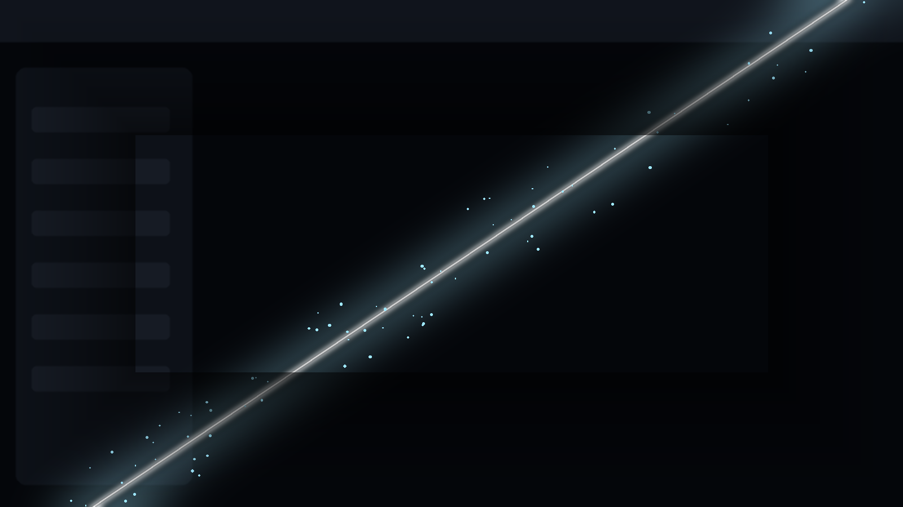

# dsh-startup-blade · blade-draw splash for DeepSeek Harness

> A blade is unsheathed, cuts the black screen open, and the UI emerges from the slash —
> freezing on the frame of the wallpaper you are looking at.

A decoration-only plugin: roughly **2.6 s** of startup animation, once per app launch, then it
removes itself. Nothing stays mounted, no idle CPU, no input blocked.



## Timeline

| Time | Frame |
| --- | --- |
| 0.00–0.20s | Black drops in, a cold glint at the scabbard |
| 0.18–0.78s | **Draw**: the blade sweeps bottom-right → top-left, the screen shakes slightly, and the black is genuinely *cut* — the real UI shows through the wound |
| 0.78–1.10s | White flash plus a thin lingering cut line |
| 1.10–2.40s | The black dissolves; sparks fall |
| 2.40s+ | **Freeze**: rests on the live UI (wallpaper already rendered), or on your own frozen frame for `hold` ms |

It will not replay on a page refresh in the same app session, and a click / any key skips
straight to the end.

## Install

```sh
dsh plugin --profile web add dsh-startup-blade
```

Restart DeepSeek Harness afterwards (client plugins are mounted at startup; a page refresh is
not enough).

## Freeze on your own frame

Default is **reveal mode**: the slash exposes the live UI, so the ending *is* your current frame
and needs no image.

### The character actually moving: clip mode

The streak version is decoration. To see **the character in your wallpaper** draw the blade, the
only faithful route is a recording — those characters are usually rigged Wallpaper Engine puppet
scenes whose motion lives in `.mdl` bones, with no exportable video asset.

Drop a 3–5 s clip at `%DSH_HOME%\startup-blade\splash.mp4` (or `splash.webm`) and the plugin
switches to **clip mode**: play through → hold on the last frame for `hold` ms → fade to the UI.
Click/key skips; a decode failure falls back to the streak version instead of a black screen.
1920×1080, H.264, no audio track, under 5 s, no UI overlay in frame.

For a hard freeze on a still: drop a screenshot at
`%DSH_HOME%\startup-blade\frame.png` (also `frame.jpg`, `frame.jpeg`, `frame.webp`). The plugin
switches to freeze mode automatically. `assets/frame-sample.jpg` is a placeholder you can copy
there to try it.

The plugin ships **no wallpaper artwork**; your frame stays on your machine.

## Config

`%DSH_HOME%\startup-blade\config.json` overrides the row config in `cordis.patch.yml`.

| Key | Default | Meaning |
| --- | --- | --- |
| `enabled` | `true` | master switch |
| `speed` | `1` | playback multiplier, `0.5`–`2` |
| `hold` | `620` | freeze hold (ms) |
| `accent` | `#9fe8ff` | blade colour |
| `mode` | `auto` | `auto` / `reveal` / `freeze` |

Runtime escape hatches: `?nosplash` in the URL, or
`localStorage.setItem('dsh-startup-blade:off','1')`.

## Compatibility

DSH desktop / web profile, standard `dsh.bundle.patch` + `dsh.client`, no runtime dependencies,
no build step. Honours `prefers-reduced-motion`.

## License

MIT.
